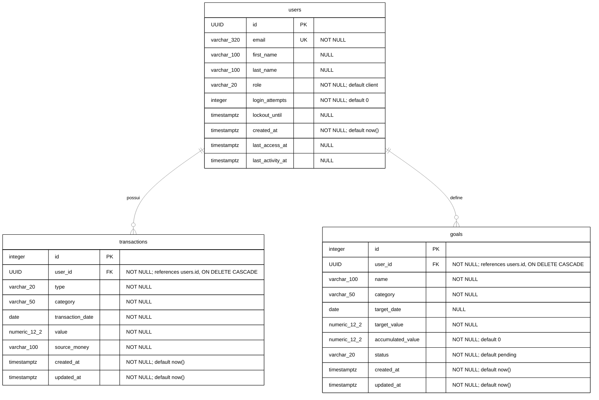

# Diagrama entidade-relacionamento

Este diagrama representa as tabelas de domínio presentes nos models SQLAlchemy e na cadeia atual de migrations Alembic. Tipos e nulabilidade vêm das declarações dos models e das migrations de criação; as chaves estrangeiras e cardinalidades refletem as constraints declaradas no banco.

## Entidades e regras verificadas

- **`users`**: chave primária `id` (UUID) e unicidade em `email`. `role` aceita `admin` ou `client`; `login_attempts` não pode ser negativo. `lockout_until` e `last_activity_at` são adicionados pela migration de controle de sessão.
- **`transactions`**: chave primária inteira `id`; `user_id` é FK obrigatória para `users.id` com exclusão em cascata. `type` é limitado a `inflow` ou `outflow`; `value` deve ser maior que zero. Há índice em (`user_id`, `transaction_date`).
- **`goals`**: chave primária inteira `id`; `user_id` é FK obrigatória para `users.id` com exclusão em cascata. `status` é limitado a `pending` ou `done`; `target_value` deve ser maior que zero e `accumulated_value` não pode ser negativo. Há índice em `user_id`.

As cardinalidades `users ||--o{ transactions` e `users ||--o{ goals` indicam que cada transação/meta referencia exatamente um usuário, enquanto um usuário pode ter zero ou várias transações/metas. As migrations não declaram unicidade para essas FKs.

## Escopo e observações

Foram incluídas apenas as tabelas atuais `users`, `transactions` e `goals`, definidas por `apps/server/src/models/auth/user.py`, `apps/server/src/models/transaction.py`, `apps/server/src/models/goal.py` e suas migrations Alembic. `auth_login_attempts` e `financial_categories` aparecem apenas no caminho de migração/rollback legado, não como entidades atuais; tokens e sessões também não são tabelas modeladas nessa cadeia.

O SQLAlchemy model de `users` e as migrations declaram os campos, tipos, constraints e defaults usados aqui. A declaração do ID não especifica geração automática no banco. `updated_at` tem default `now()` na migration e configuração `onupdate` no ORM; a migration não cria trigger de atualização. Os tipos `timestamptz`, `numeric(12,2)` e `varchar(n)` são formas legíveis equivalentes a `DateTime(timezone=True)`, `Numeric(12,2)` e `String(n)`.
